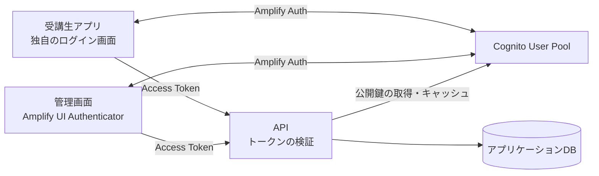

# ログイン（認証）の設計

受講生アプリ（apps/mobile）と管理画面（apps/admin）から、Amazon Cognitoでログインし、そのトークンでAPI（apps/api）を呼べるようにする。
採用するSDKとトークンの検証方式は[ADR-0012](../adr/0012-login-sdk-and-token-verification.md)で判断する。ADR-0012が`Accepted`になるまで、この文書は提案として扱う。

## 目的

ログインの範囲は次のとおり。

- ログインとログアウト
- アプリを開き直したときのログイン状態の復元と、トークンの更新
- パスワードの再設定（忘れたとき）
- APIでのトークンの検証と、ログイン中のユーザーを返す`GET /api/v1/me`

### やらないこと

ユーザーの発行・停止・削除、初回のパスワード設定、CognitoとアプリケーションDBの同期は、ユーザー登録として別に設計する（[ADR-0002](../adr/0002-user-registration-and-invitation.md)）。権限表（誰が何を見られるか）とMFAも扱わない。

## 前提

- 認証基盤はCognito User Poolを使う（[ADR-0007](../adr/0007-aws-and-cognito.md)）。
- ログインする人は、Cognitoとアプリケーションの両方にユーザーとして登録済みとする。登録の機能ができるまで、開発環境ではCognitoのコンソールかCLIでユーザーを作り、アプリケーションDBにはseedで同じユーザーを入れる。
  作っただけのユーザーはパスワードの変更待ち（`FORCE_CHANGE_PASSWORD`）になり、この設計のログインの流れではログインできない。`admin-set-user-password --permanent`でパスワードを確定させてから使う。
- 自分でアカウントを作る画面（サインアップ）は作らない。

## 全体の構成

| 担当 | 受け持つこと |
| --- | --- |
| Cognito | パスワードの確認、パスワードの再設定、トークンの発行と更新 |
| 受講生アプリ・管理画面 | ログイン画面、ログイン状態に応じた画面の切り替え、APIへのトークンの付与 |
| API | トークンの検証、ユーザーの特定 |
| アプリケーションDB | ユーザーの業務情報 |

認証（だれか）はCognitoが、認可（何をしてよいか）はAPIが受け持つ。画面の出し分けは、APIの認可の代わりにしない。

## データと信頼境界

| 境界 | 扱うもの | 守り方 |
| --- | --- | --- |
| 利用者とCognito | パスワード | アプリはSRPでCognitoとやり取りし、パスワードをAPIへ送らない |
| アプリの中 | Access Token・Refresh Token | 受講生アプリは暗号化された保存先に置く方針で、置けるかはPoCで確かめる。管理画面はXSSを防ぐ（詳細は各アプリの節） |
| アプリとAPI | Access Token | APIが毎回署名と中身を検証する（APIの節の「検証すること」） |
| APIとアプリケーションDB | ユーザーの識別子（`sub`） | `auth_subject`で紐付ける。パスワードやトークンは保存しない |

Cognitoへの外部接続は、アプリからのログインと、APIからの公開鍵（JWKS）の取得だけにする。

## Cognitoの設定

| 項目 | 設定 |
| --- | --- |
| User Pool | 環境ごとに分ける（dev・stg・prod）。同じ環境の受講生アプリと管理画面は同じUser Poolを使う |
| App Client | 受講生アプリ用と管理画面用に分ける。どちらもClient Secretを持たない（アプリに秘密値を埋め込めないため） |
| ログインの方式 | SRP（パスワードを送らずに確認する方式）とトークンの更新だけを許可する |
| サインアップ | 管理者だけがユーザーを作れる設定にする |
| ユーザーの存在 | 存在しないユーザーとパスワード誤りを区別しないエラーを返す設定（Prevent user existence errors）を有効にする |

ログインIDをメールアドレスにするかどうかは、ユーザー登録の設計で決める。ログインの画面は、IDとパスワードを入れる形で作る。

## 受講生アプリ（apps/mobile）

ログイン画面は独自のデザインで作り、Cognitoとのやり取りはAmplify Authに任せる。

### 画面

- ログイン
- パスワード再設定の申請（メールアドレスを入れる）
- パスワード再設定（届いた確認コードと新しいパスワードを入れる）

### ログインの結果ごとの扱い

`signIn`の結果（`nextStep`）で次の画面を決める。

| 結果 | 扱い |
| --- | --- |
| `DONE` | `GET /api/v1/me`を呼び、成功したらホームへ進む |
| `RESET_PASSWORD` | パスワード再設定の画面へ進む |
| `CONFIRM_SIGN_IN_WITH_NEW_PASSWORD_REQUIRED` | 登録の手続きが終わっていないと表示する。新しいパスワードを設定する画面は作らない（初回の設定はユーザー登録で扱う） |
| MFAなど上記以外 | 対応していないと表示し、ログインを終える |

### 開発環境

Amplify AuthはExpo Goでは動かないため、Development Build（ネイティブ部分を含めたアプリを自分でビルドしたもの）を使う。TypeScriptの変更はこれまでどおりFast Refreshで反映し、ネイティブの依存を変えたときだけビルドし直す。
Expo SDK 58との互換性はまだ確かめていない。最初の検証（PoC）で確かめる。

### トークンの保存先

Amplify AuthのReact Native版は、既定ではトークンをAsyncStorageに保存する（暗号化されない）。Expo SecureStoreに保存先を差し替えられるかはまだ確かめていない。PoCで確かめる。

## 管理画面（apps/admin）

ログイン・パスワード再設定の画面は、Amplify UIの`Authenticator`を使い、テーマをSONOMAMAに合わせる。サインアップの画面は出さない（`hideSignUp`）。
デザインの要件を満たせないときは、受講生アプリと同じく独自の画面に切り替える。

AmplifyのWeb版は、既定ではトークンをブラウザのlocalStorageに保存する。XSS（画面に他人のスクリプトを埋め込まれる攻撃）があるとトークンを読まれるため、`dangerouslySetInnerHTML`などを使わないことをレビューで確かめる。

## 両アプリに共通する作り

- Amplifyをimportしてよいのは、`src/providers`の認証Provider（`Amplify.configure`とログイン状態の保持）と、`features/auth`（ログイン・パスワード再設定の画面）だけにする。ほかのFeatureや`shared`はAmplifyをimportしない。
- APIへのトークンの付与は、`src/shared/api/http-client.ts`のAxios interceptorで行う。interceptorは「トークンを返す関数」を受け取るだけにし、その関数は`app`の層で認証Providerから渡す（`shared`は`providers`をimportできないため）。
- interceptorは、リクエストのたびにAmplifyの`fetchAuthSession`でトークンを取る。期限が近ければAmplifyが更新する。
- APIが401を返したら、トークンを強制的に更新して1回だけやり直す。それでも401なら、ログアウトしてログイン画面へ戻す。
- 認証のテストは`features/auth`の下に置く（Harnessの認証テストがここを実行する）。認証Providerのテストも`features/auth`の下に置く。

### ログアウト

1. Amplifyの`signOut`を呼ぶ。
2. TanStack Queryのキャッシュなど、ユーザーごとのデータを消す。
3. ログイン画面へ戻す。

`signOut`のあとも、発行済みのAccess Tokenは期限が切れるまでAPIで使える。すぐに使えなくする必要があるかは、アカウント停止と合わせてユーザー登録の設計で決める。

## API（apps/api）

### 受け取るトークン

`Authorization: Bearer <Access Token>`で受け取る。ID TokenはAPIの認証に使わない。

### 検証すること

次のすべてを満たしたときだけ、トークンを正しいとみなす。満たさないトークンの中身は使わない。

1. 署名のアルゴリズムが`RS256`である（`none`などほかのアルゴリズムは受けない）。
2. 署名が、対象のUser Poolの公開鍵（JWKS）で検証できる。
3. `iss`が、その環境のUser Poolのものと一致する。
4. `token_use`が`access`である。
5. `exp`が切れていない。
6. `client_id`が、受講生アプリ用か管理画面用のApp Clientのものである。

公開鍵は取得してキャッシュし、リクエストのたびにCognitoへ問い合わせない。知らない鍵ID（`kid`）のトークンが来たときは鍵を取り直す。ただし、取り直す頻度に上限を設ける（偽のトークンで何度もCognitoへ問い合わせさせないため）。

検証は1か所にまとめ、各Controllerは検証済みのユーザーだけを受け取る。Cognito専用のgemは使わず、汎用のJWTライブラリで検証する。

### ユーザーの特定

トークンの`sub`（Cognitoが付けるユーザーの識別子）で、アプリケーションDBのユーザーを探す。メールアドレスは変わりうるので、紐付けには使わない。

ユーザーのテーブルはまだない。作るときに、列の名前はCognito固有の名前を避けて`auth_subject`とし、一意制約を付ける。

### エラー

| 状況 | ステータス |
| --- | --- |
| トークンがない | 401 |
| トークンが正しくない、期限が切れている | 401 |
| トークンは正しいが、アプリケーションDBにユーザーがいない | 403 |

ユーザーがいないときに403とするのは、ログインし直しても解決しないため。

エラーの本文の形はAPIの共通の仕様に合わせる。トークンやパスワードはログに出さない。

### `GET /api/v1/me`

ログイン中のユーザーを返す。返す項目は、OpenAPIの変更（Schema SBI）で決める。

## テスト

APIの認証テストは`apps/api/spec/authentication/`に置く（Harnessの認証テストがここを実行する）。

| 対象 | 確かめること |
| --- | --- |
| API | 正しいトークン、トークンなし、署名の誤り、期限切れ、別のUser Poolのトークン、別のApp Clientのトークン、ID Token、`RS256`以外のアルゴリズム、知らない`kid`、DBにいないユーザー |
| 受講生アプリ・管理画面 | ログインの成功と失敗、`nextStep`ごとの画面、パスワード再設定、ログアウトでキャッシュが消えること、401のときに1回だけやり直すこと |
| 通し | 両アプリからログインして`GET /api/v1/me`が成功すること |

## 進め方

1. PoC: dev環境のUser Poolを作り、両アプリからログインして`GET /api/v1/me`を呼べることを確かめる。Expo SDK 58との互換性とトークンの保存先もここで確かめる。
2. APIのトークン検証と`GET /api/v1/me`
3. 受講生アプリのログイン・パスワード再設定・ログアウト
4. 管理画面のログイン・パスワード再設定・ログアウト

## 未決事項 / 関連ADR

- Access Tokenの有効期間（5分〜1日の範囲で、App Clientごとに設定できる）
- 受講生アプリでトークンをSecureStoreに保存できるか（PoCで確認）
- 管理画面でAmplify UIのデザインが許容されるか
- ログインIDの形式（メールアドレスをユーザー名にするか）。User Poolを作ったあとには変えられないため、PoCのdev環境のUser Poolは作り直す前提とし、stg・prodのUser Poolを作るまでにADR-0002の側で決める
- アカウント停止時の扱い、MFA（ユーザー登録・権限の設計で決める）

関連ADR: [ADR-0007](../adr/0007-aws-and-cognito.md)、[ADR-0012](../adr/0012-login-sdk-and-token-verification.md)、[ADR-0002](../adr/0002-user-registration-and-invitation.md)
